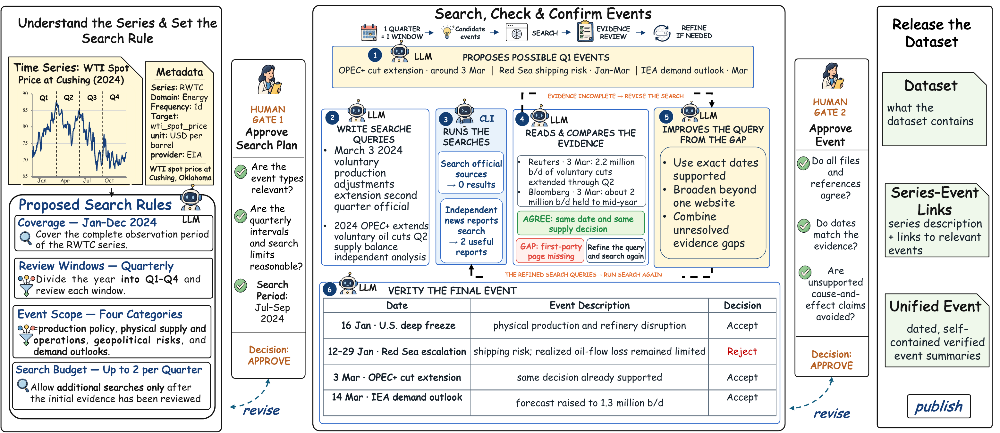

# World2TS

**Real-world event context for time-series forecasting.**

World2TS is a reusable framework for augmenting heterogeneous time-series data
with auditable, time-honest, series-scoped real-world events. It can collect
supported remote series or start from existing local Arrow data, so its use is
not limited to the datasets constructed for the accompanying paper. The paper
snapshot contains 31 datasets across six domains, comprising 4,179 series,
97.1 million observations, 1,159 verified events, and 56,846 event-series
links.

World2TS includes three complementary parts: `world2ts-core` for constructing
event-aware datasets, `world2ts-data` as the cross-domain research dataset, and
`world2ts_eval` as a compact forecasting evaluation environment.

## Paper and data

| Artifact | Status | Link |
|---|---|---|
| Paper | Coming soon | `PAPER_URL_TBD` |
| Dataset | Coming soon | `DATA_URL_TBD` |

The placeholders above will be replaced when the public paper and dataset
locations are finalized.

## Framework

World2TS follows an **Agent–CLI–Human** workflow. Remote inputs first cross a
strict acquisition boundary that produces Arrow data and validated metadata,
while existing Arrow datasets enter through the same metadata contract. The
Agent interprets what each series measures, designs time-window search plans,
examines evidence, writes canonical event descriptions, and determines the
relevant series scope; the CLI performs source access, schema validation,
deterministic checks, resumable state transitions, and artifact publication.
Human review approves the search strategy before retrieval and the quality
report before release, after which the framework publishes a minimal dataset
containing dataset information, series-event links, and unified events.



The responsibility boundary is deliberate:

- **Agent = semantic brain:** research, interpretation, query design, event
  selection, canonicalization, projection, and content-quality judgment.
- **CLI = mechanical hands:** collection, source execution, validation,
  deterministic statistics, state management, and transactional persistence.
- **Human = approval authority:** review the proposed search scope and the
  final data quality. The CLI never infers approval.

World2TS does not silently invent descriptions, queries, selections, links, or
compatibility data. Forecast, decision, concurrent, and retrospective context
is allowed only when its temporal role is represented honestly; association is
not presented as causation.

## Agent skills

The complete operating procedure is encoded in the checked-in Agent skills,
rather than duplicated in this README. Together they cover the full path from
acquisition or local Arrow preparation through semantic validation, two review
gates, evidence search, canonicalization, projection, audit, and publication.
Read the shared contract first.

| Skill | Purpose |
|---|---|
| [`world2ts-shared`](.agents/skills/world2ts-shared/SKILL.md) | Shared contracts, responsibility boundaries, and source policy |
| [`world2ts-collect`](.agents/skills/world2ts-collect/SKILL.md) | Strict remote acquisition into Arrow plus OfflineMetadata |
| [`world2ts-metadata`](.agents/skills/world2ts-metadata/SKILL.md) | Metadata preparation and validation for existing Arrow data |
| [`world2ts-offline-discover`](.agents/skills/world2ts-offline-discover/SKILL.md) | End-to-end discovery, review, audit, and publication workflow |

For local Arrow whose columns do not contain enough meaning on their own, the
Agent must obtain semantics from a data dictionary, source documentation, or
user-provided context. The CLI validates those semantics but does not guess
them from filenames or numerical patterns.

## Install

World2TS requires Python 3.9 or later.

```bash
pip install -e .
world2ts-core --help
```

Inspect the registered data-source capabilities with:

```bash
world2ts-core sources list
world2ts-core --json sources list --domain energy
```

Use the `world2ts-collect` skill for a remote dataset. For existing Arrow data,
start with `world2ts-metadata` and continue with `world2ts-offline-discover`.
Every command exposes its exact contract through `--help`, and machine-readable
output is available by placing `--json` before the command.

Optional project configuration lives in `world2ts.toml`:

```toml
http_proxy = "http://127.0.0.1:7890"
# store_root = "./store"
# http_timeout = 60
```

Configuration precedence is CLI, `WORLD2TS_*`, local `world2ts.toml`, then the
user configuration.

## Evaluation

[`world2ts_eval`](world2ts_eval/README.md) provides a basic forecasting
evaluation framework adapted from
[THUML Time-Series-Library](https://github.com/thuml/Time-Series-Library). It
supports controlled comparisons between numerical-only inputs and inputs that
also contain World2TS metadata and event context. In the paper experiments,
adding World2TS context improves context-aware forecasters across most evaluated
domains and metrics, although contextual information is not guaranteed to help
every individual forecast.

The evaluator uses a separate dependency environment; see its README for data
layout, installation, model adapters, and commands.

## Milestones

✅ **2026.10** Consolidated project resources and open-sourced World2TS.

✅ **2026.08** Renamed the project to World2TS and introduced the
TSLib-based forecasting evaluation framework.

✅ **2026.07** Completed the unified offline workflow, two human
review gates, semantic projection, quality audit, and minimal three-file
publication.

✅ **2026.06** Added unified event representations, Tavily and
AnySearch retrieval, calendar recall, and adaptive search feedback.

✅ **2026.04** Established multi-domain collection, strict Arrow
plus OfflineMetadata inputs, and metadata preparation for existing datasets.

✅ **2026.03** Created the initial CLI and the Agent-as-brain /
CLI-as-hands collaboration model.

## Repository layout

```text
world2ts_core/       collection, metadata, discovery, validation, publication
world2ts_eval/       TSLib-based forecasting evaluation
.agents/skills/      complete Agent operating procedures
assets/              public framework figure
tests/               core unit and integration tests
```

Local datasets and run artifacts belong under the Git-ignored `store/`
directory or another user-selected path.

## Citation

If you find World2TS useful, please cite our paper:

```bibtex
@misc{liu2026world2ts,
  title  = {World2TS: Real-World Event Context for Time-Series Forecasting},
  author = {Zhiding Liu and Jiqian Yang and Mingyue Cheng and Zhi Li and Enhong Chen},
  year   = {2026},
  note   = {Manuscript}
}
```
